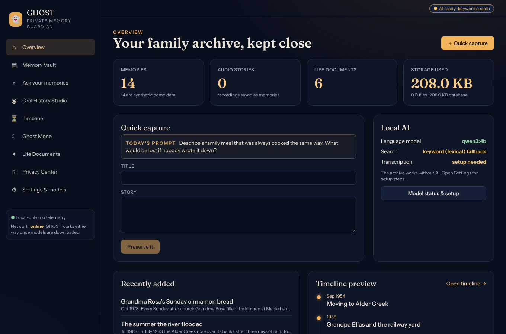
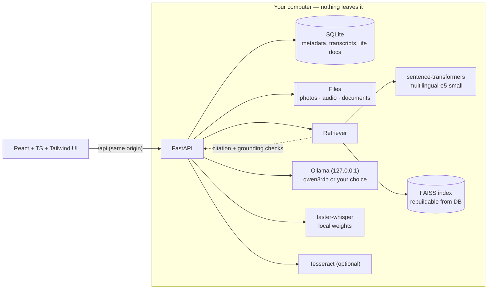

# 👻 GHOST — Generative Human-memory Offline Storytelling & Tracking

**A private memory archive for the stories your family could lose, powered by open-weight AI that runs on your own computer.**

Preserve letters, recipes, photographs and oral histories. Ask questions in plain language and get answers that **cite the exact memories they came from — or say "I couldn't find that in your saved memories."** Nothing is sent to a cloud AI. No account, no telemetry, no vendor to disappear.

> Built for the *Ghost in the Machine* open-source AI challenge. Ghost Mode is an optional, clearly-labelled fiction layer; GHOST never claims to contact or speak for anyone who has died.



<sub>Screenshots in `docs/img` show the real UI on the synthetic demo archive. Where AI text appears (Ask, summary, Ghost Mode) it was produced by a throw-away **test stub standing in for Ollama**, not by Qwen — the sandbox that built this project cannot download model weights. See [`docs/STATUS.md`](docs/STATUS.md).</sub>

## Why it is different

| Most "AI memory" apps | GHOST |
|---|---|
| Upload your family's private stories to a hosted model | Open-weight models run **locally**: Ollama (LLM), sentence-transformers (embeddings), faster-whisper (speech) |
| Answers can be confident inventions | Answers are **grounded**: every claim must cite a retrieved memory; invalid citations are stripped; uncited answers are discarded; unsupported questions get a fixed refusal |
| Archive lives in a proprietary service | SQLite + plain files, JSON/Markdown/ZIP export, documented restore |
| "Offline" is a slogan | Honest health checks distinguish *offline-ready* from *currently offline*; see [`docs/STATUS.md`](docs/STATUS.md) for exactly what has and has not been verified |

## Features

Memory Vault (CRUD, people/tags/categories, photo/audio/document attachments, OCR) · AI Memory Search with cited RAG · Oral History Studio (record/upload → local transcription → editable → confirmed memory) · Timeline with filters, related memories and family-history summaries from *selected records only* · Ghost Mode (Gentle / Mysterious / Spooky / **Remembrance**, with verified facts separated from invented details) · Life Documents with `.ics` reminders · Privacy Center (passphrase lock, storage folder, JSON/Markdown/ZIP backup) · Settings & model status · bundled **synthetic** demo archive (the fictional Hartwell family).

## Quick start (Windows 11, PowerShell)

```powershell
git clone <your-fork-url> ghost-memory-guardian ; cd ghost-memory-guardian
powershell -ExecutionPolicy Bypass -File scripts\setup.ps1          # venv + pinned deps + UI build (no model downloads)
powershell -ExecutionPolicy Bypass -File scripts\dev.ps1            # backend :8000 + UI :5173  → http://localhost:5173
```

Linux/macOS: `scripts/setup.sh && scripts/dev.sh`. Single-process mode (after the UI is built): `scripts/serve.sh` → <http://127.0.0.1:8000>.

Open **Settings → Load demo archive** to explore without any personal data. The app works immediately with no AI models (keyword search, vault, timeline, exports, life documents). Add the AI pieces when you want them:

```powershell
# 1. Local LLM (Apache-2.0 model, ~2.5 GB, runs on CPU)
winget install Ollama.Ollama ; ollama pull qwen3:4b
# 2. Multilingual embeddings + speech recognition (asks before downloading ~600 MB)
.\.venv\Scripts\pip.exe install -r backend\requirements-ml.txt
.\.venv\Scripts\python.exe scripts\download_models.py --all
```

Full guide, CPU/RAM trade-offs and troubleshooting: [`docs/INSTALL.md`](docs/INSTALL.md), [`docs/TROUBLESHOOTING.md`](docs/TROUBLESHOOTING.md).

## Tests and evaluation

```powershell
cd backend ; ..\.venv\Scripts\python.exe -m pytest        # backend
cd frontend ; npm test                                    # frontend (Vitest)
.\.venv\Scripts\python.exe scripts\evaluate.py --out docs\EVAL_REPORT.md   # retrieval/answer metrics on the synthetic archive
```

## Architecture



Details: [`docs/ARCHITECTURE.md`](docs/ARCHITECTURE.md). Privacy and security model: [`docs/PRIVACY_AND_SECURITY.md`](docs/PRIVACY_AND_SECURITY.md). Backup/restore: [`docs/BACKUP.md`](docs/BACKUP.md). Offline test procedure: [`docs/OFFLINE.md`](docs/OFFLINE.md).

## Honest limitations

* Local storage is **not encrypted**; the passphrase lock protects the app/API, not the files on disk. Use BitLocker/LUKS/FileVault.
* Small local models can still make mistakes. GHOST validates citations and flags names/years that do not occur in the sources, but this is a safety net, not proof. Always check important details against the original memory.
* Speech recognition and OCR make errors; transcripts are editable drafts and must be confirmed.
* Without the neural embedding model, search is keyword-based (still cited, still grounded) and finds shared words rather than shared meaning.

## Licenses

GHOST is MIT-licensed ([`LICENSE`](LICENSE)). Model and third-party licenses: [`docs/MODELS_AND_LICENSES.md`](docs/MODELS_AND_LICENSES.md). The demo archive is entirely fictional.
